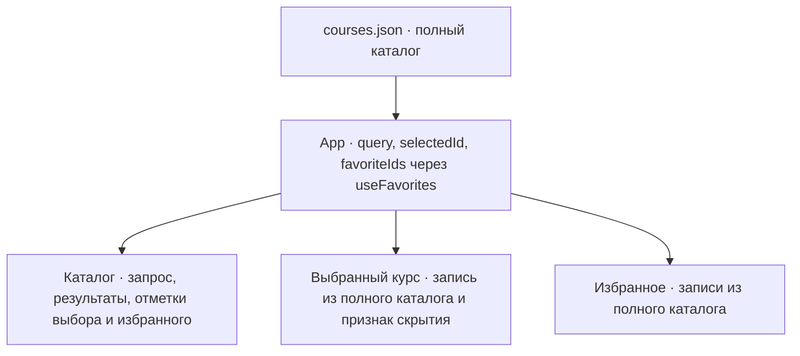

# 12. Review состояния небольшого dashboard

[Папка решения на GitHub](https://github.com/SAQ-047/TechOrda/tree/react-12-dashboard-state-review/Advanced_React/12-dashboard-state-review)

## Владельцы состояния

`App` владеет строкой поиска `query` и идентификатором `selectedId`. Один вызов `useFavorites` в `App` хранит `favoriteIds`. Эти три значения отражают самостоятельные действия пользователя и обслуживают несколько частей интерфейса. `courses.json` содержит исходный каталог.



`App` вычисляет `visibleCourses` по запросу, `selectedCourse` по `selectedId` и `favoriteCourses` по `favoriteIds`. Оба счётчика читают длину соответствующего списка. Признак `hiddenBySearch` вычисляется по наличию выбранного курса в результатах.

Выбранная карточка использует полный каталог и остаётся в отдельной панели, даже когда в результатах ноль курсов. В таком случае панель сообщает «Выбранный курс вне результатов текущего поиска». «Очистить поиск» меняет только `query`. «Очистить избранное» очищает только `favoriteIds`. Выбор курса меняется при нажатии на карточку в каталоге.

## Два отклонённых варианта

1. **Хранить производные данные в state.** Отдельные копии результатов, числа совпадений и объекта курса пришлось бы обновлять вместе с запросом, ID и каталогом. Например, пропущенное обновление счётчика показало бы старое число рядом с новым списком. Вычисление в рендере даёт значения из одного снимка исходных данных.
2. **Хранить выбор и избранное отдельно внутри панелей.** Если каталог и избранное вызывают `useFavorites` по отдельности, отметка в каталоге и список панели обновляются независимо. Если ID выбора живёт внутри карточки каталога, скрытие карточки размонтирует владельца выбора. Один общий владелец в `App` сохраняет значения при фильтрации и передаёт обеим панелям согласованные данные.

## Запуск

Команды запуска выполняются из папки `Advanced_React`.

```bash
npm ci
npm run dev:12
```

После общей установки из папки задания также работает `npm run dev`. [Открыть локальное приложение](http://127.0.0.1:5184/)

Для локального просмотра сборки выполните эти команды из `Advanced_React`.

```bash
npm run build --workspace=12-dashboard-state-review
npm run preview:12
```

[Открыть собранное приложение](http://127.0.0.1:4184/)

## Версии и самопроверка

React и React DOM 19.3.1, Vite 8.3.6, `@vitejs/plugin-react` 6.3.0. Проверено на Node.js 20.20.2, npm 10.9.4 и Brave 158.1.100.58. [Версии зависимостей](../package.json) · [Lockfile](../package-lock.json)

`npm ci` и сборка всех двенадцати заданий прошли. В браузере проверены dev с `StrictMode` и production.

| Действие | Результат |
| --- | --- |
| Выбрать React и добавить React и TypeScript в избранное | Выбран React, в избранном два курса |
| Ввести `  сЕРВЕР  ` | Один результат, карточка React остаётся в отдельной панели с пояснением, избранное содержит два курса |
| Очистить избранное при активном запросе | Избранное пусто, запрос и выбор React сохраняются |
| Добавить серверный курс в избранное и ввести запрос без совпадений | Ноль результатов, карточка React и серверный курс в избранном видны |
| Очистить поиск | Возвращаются четыре курса, React отмечен как выбранный, избранное сохраняется |
| Выбрать TypeScript и дважды переключить его избранное | Выбран TypeScript с нулём мест, число в избранном сначала растёт, затем возвращается к прежнему значению |

Также проверены клавиатура, ширина 320 px, ошибки JavaScript и загрузка ресурсов. Счётчики соответствовали спискам, данные курсов загрузились из локального модуля.

В файлах решения **169 непустых строк** HTML, CSS, JS и JSX, включая `useFavorites` из задания 11. Унаследованный без изменений `src/main.jsx` в подсчёт не входит. [Ответ с полным кодом для LMS](LMS.md)
